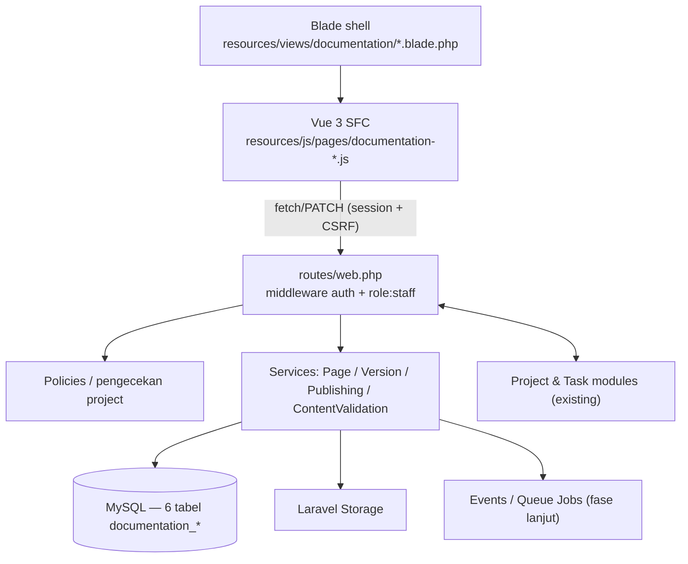
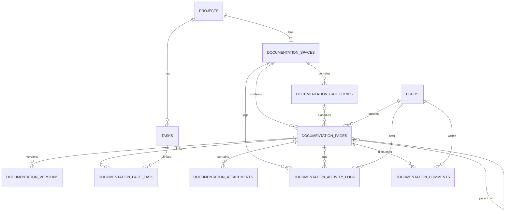
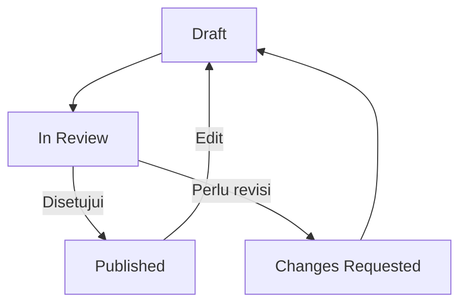

# Rancangan Teknis: Technical Documentation Management (IceSum)

## 1. Ringkasan

Modul **Technical Documentation Management** dirancang sebagai fitur internal pada
aplikasi **IceSum** (project & task management + e-invoice) berbasis Laravel dan MySQL
yang sudah ada. Modul ini menyediakan workspace dokumentasi per project, editor visual,
version history, workflow publikasi, serta hubungan langsung dengan `Task`.

Dokumen ini sudah **disesuaikan dengan struktur project existing** (lihat Bagian 2).
Setiap tempat yang menyimpang dari konvensi aplikasi saat ini ditandai dengan
**⚠️ Deviasi** beserta alasannya, agar keputusan diambil sadar, bukan kebetulan.

### Status implementasi (Tahap 1–4 — selesai)

- Keputusan final: **Tiptap v3**, akses **cukup `role:staff`**, **hard delete + disk `public`**.
- Sudah terpasang: 8 tabel `documentation_*` (6 inti + `documentation_activity_logs` +
  `documentation_comments`), 7 model + factory, 2 enum (`DocumentationPageStatus`,
  `DocumentationActivityAction`), 7 service (termasuk `HtmlRenderer`, `MarkdownRenderer`,
  `ActivityLogger`), 10 controller, route di `routes/web.php`, shell Blade + SFC Vue 3
  (editor Tiptap dengan tabel & gambar, autosave, tree, filter kategori/status, versi,
  task link, lampiran, komentar, pencarian isi, pratinjau dengan diagram Mermaid, riwayat
  aktivitas, ekspor `.md`/PDF), seeder template, dan test Pest
  (`tests/Feature/DocumentationWorkspaceTest.php` + unit test renderer).
- Tahap lanjut yang masih terbuka: integrasi repository dan kolaborasi real-time.

### Prinsip desain

- **Terintegrasi:** memakai autentikasi, `Project`, `Task`, `User`, dan pola otorisasi
  yang sudah ada. Tanpa sistem role duplikat.
- **Terstruktur:** dokumen dikelompokkan per project, kategori, dan hierarki halaman.
- **Visual:** editor berbasis blok, disajikan sebagai SFC Vue 3 di dalam shell Blade
  (pola frontend existing), bukan halaman terpisah.
- **Terkelola:** draft, review, publikasi, version history, dan audit aktivitas.
- **Dapat dikembangkan:** pencarian, ekspor, dan integrasi repository masuk fase lanjut.

---

## 2. Hasil Audit Struktur Existing

Bagian ini adalah dasar penyesuaian. Semua keputusan di dokumen ini mengacu ke sini.

### 2.1 Stack & tooling

| Aspek | Kondisi existing | Bukti |
|---|---|---|
| Framework | Laravel `^13.17`, PHP `^8.3` (runtime 8.4) | `composer.json` |
| Database | MySQL 8 di runtime; **SQLite `:memory:`** untuk test | `.env`, `phpunit.xml` |
| Frontend | **Blade shell + Vue 3 SFC** via Vite (entry per halaman) | `vite.config.js`, `resources/js/pages/*.js` |
| CSS | Tailwind CSS v4 (`@tailwindcss/vite`) | `package.json` |
| JS global | `toastify-js`, `sortablejs`; flash lewat `window.showToast` | `resources/js/app.js` |
| Livewire / Inertia | **Tidak dipakai** | `composer.json`, `package.json` |
| Rich text editor | Tiptap v3 (`@tiptap/vue-3`, `@tiptap/starter-kit`, `@tiptap/extension-placeholder`) | `package.json` |
| Testing | Pest 4 + `RefreshDatabase`; nama test berbahasa Indonesia | `tests/Feature/*` |
| Queue | `QUEUE_CONNECTION=database`; belum ada `app/Jobs` | `.env`, tidak ada folder |
| MCP | Server `IceSumServer` di `/mcp/icesum` | `routes/ai.php`, `app/Mcp` |

### 2.2 Skema database existing yang relevan

- `users`: `id`, `name`, `username` (unique), `email`, `password`, `role` (**string**, default
  `staff`, cast ke enum `UserRole`), `customer_id` (nullable FK), timestamps.
- `projects`: `id`, `customer_id` (FK), `name`, `description`, `rate` `decimal(15,2)`,
  `pricing_type` enum(`fixed`,`hourly`), `archived_at`, timestamps. **Tanpa `deleted_at`** —
  arsip memakai `archived_at` + scope `active()`/`archived()`.
- `project_user`: pivot `project_id` + `user_id`, **composite primary key, tanpa timestamps,
  tanpa kolom tambahan**. Dipakai untuk *assignment* anggota, **bukan** untuk otorisasi.
- `task_groups`: `id`, `project_id` (FK), `name`, `color`, `order_column`, timestamps.
- `tasks`: `id`, `project_id`, `task_group_id`, `assigned_to_user_id`, `invoice_id`, `title`,
  `priority` enum, `description`, `estimation`, `fixed_price`, `billable`, `order_column`,
  `completed_at`, timestamps. **Tanpa `deleted_at`** (hard delete + cascade).
- `task_attachments`: `id`, `task_id`, `file_name`, `file_path`, `file_size`, `mime_type`,
  timestamps. File di **disk `public`** (`task-attachments/`), URL via `Storage::disk('public')->url()`.

### 2.3 Otorisasi existing (penting)

- Route staff: middleware `['auth', 'role:staff']`. Route customer: `['auth', 'role:customer']`
  dengan prefix `portal`. Alias `role` → `App\Http\Middleware\EnsureRole`.
- `App\Enums\UserRole` hanya punya `STAFF` dan `CUSTOMER`.
- **Tidak ada** permission granular / RBAC / Spatie Permission.
- `App\Policies\ProjectPolicy` dan `InvoicePolicy` **ada**, tetapi **tidak dipanggil** di controller
  mana pun, dan `App\Http\Controllers\Controller` (abstract) **belum memakai trait
  `AuthorizesRequests`**. Otorisasi nyata saat ini = middleware role + pengecekan manual
  `abort_unless(...)` (contoh: `Portal\ProjectController::show`).
- Page customer (`Portal\*`) memverifikasi kepemilikan via `customer_id`, bukan policy.

> **Implikasi:** modul dokumentasi tidak bisa mengandalkan "permission existing" yang
> granular. Ia harus memakai `role:staff` + (opsional) keanggotaan `project_user`, dan
> **kita perlu memutuskan** apakah sekalian merapikan pemakaian Policy (lihat Bagian 10).

### 2.4 Konvensi kode yang wajib diikuti

- Model: atribut **`#[Fillable([...])]`** (gaya Laravel 13), method `casts(): array`,
  relasi ber-PHPDoc generic (`/** @return BelongsTo<Task, $this> */`), `scope*()`.
- Nama urutan kolom = **`order_column`** (bukan `sort_order`).
- Validasi inline `$request->validate([...])` di controller; Form Request hanya dipakai
  untuk `Auth\LoginRequest`. Logika kompleks/transaksi ditaruh di **Service**
  (`InvoicePdfService`, `ProjectInvoiceService`).
- Response non-AJAX: `redirect()->route(...)->with('success', '...')`.
  Response AJAX: `response()->json([...])` (contoh `TaskController::move`).
- Tidak ada `routes/api.php`; semua di `routes/web.php`. Handler error merender JSON bila
  `request->is('api/*')` atau `expectsJson()` (`bootstrap/app.php`).
- Tidak ada `app/Http/Resources`; payload JSON dibentuk inline dari controller.
- Routing memakai **ID + route model binding**, bukan slug (customer/invoice/project).
- Enum: `app/Enums/*` dengan `label()` (+ `badgeClass()` untuk `TaskPriority`).
- Seeder: `DatabaseSeeder` memanggil seeder fitur (`SettingSeeder`, dst).
- Frontend: entry `resources/js/pages/<halaman>.js` didaftarkan di `vite.config.js`,
  root SFC di `resources/js/components/<fitur>/`, config server → klien lewat
  `data-config='@json($cfg)'`, skeleton sebelum mount, `@push('scripts') @vite([...])`.
- **Aturan Tailwind:** class tidak boleh dikirim lewat JSON; semua varian kondisional
  ditulis literal di SFC.

---

## 3. Arsitektur Teknis



### Komponen (mengikuti yang benar-benar terpasang)

| Komponen | Pilihan |
|---|---|
| Backend | Laravel 13, PHP 8.3+ |
| Database | MySQL 8 (SQLite untuk test) |
| Frontend | Blade + Vue 3 SFC + Vite + Tailwind v4 |
| Rich text editor | **Tiptap v3** (dipilih & terpasang, lihat §7.1) |
| Autentikasi | Login existing (`Auth\LoginController`), session guard |
| Otorisasi | Middleware `role:staff` (tanpa Policy, §10.2) |
| File storage | Disk `public` (`documentation-attachments/`); kolom `disk` tetap dicatat (§11) |
| Diagram | npm `mermaid` (lazy-load saat pratinjau, bukan di bundle awal) |
| Ekspor PDF | `barryvdh/laravel-dompdf` (sudah terpasang di project) |
| Testing | Pest (`tests/Feature` + `tests/Unit`) |

### Keputusan arsitektur

1. Modul tetap di aplikasi Laravel yang sama, **aturannya di `routes/web.php`** — tanpa
   `routes/api.php` dan tanpa prefix `/api/v1`.
2. Tabel `projects`, `tasks`, `users`, `project_user` existing dipakai ulang (FK `id` BIGINT).
3. Konten editor disimpan sebagai **JSON terstruktur** pada kolom `content` (cast `array`),
   bukan HTML.
4. Snapshot versi disimpan di tabel terpisah dan **immutable**.
5. File disimpan di Storage; DB hanya menyimpan metadata & path.
6. Semua operasi memeriksa otorisasi di sisi server (bukan hanya menyembunyikan tombol).
7. Semua nama kolom, enum, dan pola kode mengikuti konvensi §2.4.

---

## 4. Struktur Menu

Modul ini **internal untuk staff** (route group `role:staff`). Customer tidak diberi akses
pada MVP (⚠️ §10).

```text
Proyek: <Nama Project>            ← halaman projects.show (existing)
├── Board / List tasks            ← existing
├── Dokumentasi                   ← BARU: tab di projects.show
│   ├── Project Overview
│   ├── Architecture
│   ├── Modules & Business Flow
│   ├── Database Design
│   ├── API Reference
│   ├── Development Setup
│   └── Deployment & Operations
└── Invoice                       ← existing
```

Navigasi:

- Tambahkan tautan `Dokumentasi` di `resources/views/projects/show.blade.php`
  (atau di `ProjectHeader.vue`), bukan menu global navbar.
- Route masuk: `GET /projects/{project}/documentation`.

### Fitur workspace

| Fitur | Perilaku |
|---|---|
| Document tree | Halaman & subhalaman bertingkat (`parent_id`, urut `order_column`) |
| Search | Judul (MVP), isi dokumen (fase lanjut) |
| Quick create | Membuat halaman dari template |
| Breadcrumb | Lokasi halaman di hierarki |
| Editor | Blok teks/tabel/kode/gambar |
| Publish controls | Draft → In Review → Published |
| History | Lihat & pulihkan versi |
| Related tasks | Task project yang ditautkan |
| Attachments | Unggah/hapus lampiran |

Satu project = satu workspace dokumentasi (`unique(project_id)`). Bila butuh banyak
workspace, cukup lepas constraint unik tersebut.

---

## 5. Skema Database

Tipe PK/FK: `$table->id()` dan `$table->foreignId(...)->constrained()` (BIGINT UNSIGNED),
sesuai seluruh migration existing. Nama migration mengikuti timestamp existing, dibuat via
`php artisan make:migration`.

### 5.1 `documentation_spaces`

| Kolom | Tipe | Keterangan |
|---|---|---|
| `id` | id() | PK |
| `project_id` | foreignId → `projects` | `cascadeOnDelete`, **`unique`** |
| `name` | string(150) | Nama workspace |
| `description` | text nullable | Deskripsi |
| `created_by` | foreignId → `users` | `nullOnDelete` |
| `timestamps` | | |

### 5.2 `documentation_categories`

| Kolom | Tipe | Keterangan |
|---|---|---|
| `id` | id() | PK |
| `space_id` | foreignId → `documentation_spaces` | `cascadeOnDelete` |
| `name` | string(100) | |
| `slug` | string(120) | |
| `order_column` | unsignedInteger, default 0 | **mengikuti konvensi existing** |
| `timestamps` | | |

Index: `(space_id, order_column)`. Unique: `(space_id, slug)`.

### 5.3 `documentation_pages`

| Kolom | Tipe | Keterangan |
|---|---|---|
| `id` | id() | PK |
| `space_id` | foreignId → `documentation_spaces` | `cascadeOnDelete` |
| `category_id` | foreignId nullable → `documentation_categories` | `nullOnDelete` |
| `parent_id` | foreignId nullable → `documentation_pages` | `nullOnDelete` |
| `title` | string(255) | |
| `slug` | string(255) | |
| `content` | json nullable | Struktur editor; cast `array` |
| `status` | string(20), default `draft` | cast ke enum `DocumentationPageStatus` |
| `created_by` | foreignId → `users` | |
| `updated_by` | foreignId nullable → `users` | `nullOnDelete` |
| `published_at` | timestamp nullable | |
| `lock_version` | unsignedInteger, default 1 | optimistic locking |
| `timestamps` | | |

Index: `(space_id, parent_id)`, `(space_id, status)`. Unique: `(space_id, slug)`.

Catatan:
- **Keputusan final — slug.** Routing tetap memakai ID (`{page}`) sesuai konvensi existing.
  Kolom `slug` disimpan untuk pencarian/ekspor; bukan sumber URL.
- **Keputusan final — hard delete.** Mengikuti existing: **tanpa `SoftDeletes`**. Menghapus
  halaman menghapus permanen (cascade ke versi, tautan task, lampiran).
- Validasi wajib mencegah `parent_id = id` sendiri dan siklus hierarki (dicek di service).

### 5.4 `documentation_versions`

Snapshot immutable.

| Kolom | Tipe | Keterangan |
|---|---|---|
| `id` | id() | PK |
| `page_id` | foreignId → `documentation_pages` | `cascadeOnDelete` |
| `version_number` | unsignedInteger | unique per page |
| `title` | string(255) | Judul saat snapshot |
| `content` | json nullable | Snapshot konten |
| `status` | string(20) | Status saat snapshot |
| `change_summary` | string(500) nullable | |
| `created_by` | foreignId → `users` | |
| `created_at` | timestamp | Snapshot tidak di-`update` → cukup `created_at` |

Unique: `(page_id, version_number)`. Snapshot tidak boleh diubah setelah dibuat.

### 5.5 `documentation_page_task` (pivot halaman ↔ task)

**⚠️ Deviasi sadar:** nama pivot mengikuti konvensi existing (`project_user`,
`label_task`) — alfabetik, composite PK, tanpa `id`/`timestamps`. `created_by` dipertahankan
karena audit tautan penting.

| Kolom | Tipe | Keterangan |
|---|---|---|
| `page_id` | foreignId → `documentation_pages` | `cascadeOnDelete` |
| `task_id` | foreignId → `tasks` | `cascadeOnDelete` |
| `created_by` | foreignId → `users` | |

Primary key komposit `(page_id, task_id)`. Validasi: `task.project_id` harus sama dengan
`space.project_id` (lihat Bagian 11).

### 5.6 `documentation_attachments`

Mengikuti penamaan kolom `task_attachments` (bukan `original_name`/`size_bytes`).

| Kolom | Tipe | Keterangan |
|---|---|---|
| `id` | id() | PK |
| `page_id` | foreignId → `documentation_pages` | `cascadeOnDelete` |
| `uploaded_by` | foreignId → `users` | `nullOnDelete` |
| `disk` | string(50) | Nama disk |
| `file_path` | string(500) | Path tersimpan |
| `file_name` | string(255) | Nama asli |
| `file_size` | unsignedBigInteger, default 0 | |
| `mime_type` | string(150) nullable | |
| `timestamps` | | |

### 5.7 `documentation_activity_logs` (activity log)

Log audit **append-only** untuk aksi penting pada halaman (dibuat, diperbarui,
dipublikasikan, dikirim review, minta revisi, restore, dihapus, task/lampiran
ditautkan-dilepas).

| Kolom | Tipe | Catatan |
|---|---|---|
| `id` | bigint PK | |
| `space_id` | FK → `documentation_spaces` | `cascadeOnDelete` |
| `page_id` | FK → `documentation_pages` **nullable** | `nullOnDelete`, agar riwayat tetap ada setelah halaman dihapus |
| `user_id` | FK → `users` nullable | `nullOnDelete` |
| `action` | varchar(40) | nilai `DocumentationActivityAction` |
| `description` | varchar(255) | deskripsi siap tampil |
| `properties` | json nullable | metadata (mis. `version_number`, `task_id`) |
| `created_at` | timestamp | append-only, tanpa `updated_at` |

> **Keputusan:** update konten dari autosave di-*throttle* (maksimal satu entri `updated`
> per user/halaman per 15 menit) agar log tidak membanjir. Perubahan konten granular tetap
> terekam di `documentation_versions` saat publikasi.

### 5.7b `documentation_comments` (komentar halaman)

Diskusi per halaman. Flat (tanpa threading) untuk MVP.

| Kolom | Tipe | Catatan |
|---|---|---|
| `id` | bigint PK | |
| `page_id` | FK → `documentation_pages` | `cascadeOnDelete` |
| `user_id` | FK → `users` nullable | `nullOnDelete` |
| `body` | text | isi komentar (maks 5000 karakter) |
| `timestamps` | | `created_at`, `updated_at` |

> **Keputusan:** hanya penulis komentar yang dapat menghapus komentarnya sendiri
> (`can_delete` dihitung per viewer; selain penulis → `403`). Hapus halaman ikut
> menghapus seluruh komentarnya via cascade.

### 5.7c Tabel tambahan (belum masuk MVP)

`documentation_reviews`, `documentation_templates`, `documentation_page_permissions`.

### 5.8 ERD



---

## 6. Relasi Eloquent

Model baru di `app/Models/`, memakai atribut `#[Fillable]` dan PHPDoc generic sesuai
konvensi existing.

### 6.1 `Project` (tambahan)

```php
use Illuminate\Database\Eloquent\Relations\HasOne;

/**
 * @return HasOne<DocumentationSpace, $this>
 */
public function documentationSpace(): HasOne
{
    return $this->hasOne(DocumentationSpace::class);
}
```

### 6.2 `Task` (tambahan)

```php
use Illuminate\Database\Eloquent\Relations\BelongsToMany;

/**
 * @return BelongsToMany<DocumentationPage, $this>
 */
public function documentationPages(): BelongsToMany
{
    return $this->belongsToMany(DocumentationPage::class)
        ->withPivot('created_by');
}
```

> Karena tabel pivot tanpa `timestamps`, **jangan** memakai `withTimestamps()`

### 6.3 `DocumentationPage`

```php
use App\Enums\DocumentationPageStatus;
use Illuminate\Database\Eloquent\Relations\BelongsTo;
use Illuminate\Database\Eloquent\Relations\BelongsToMany;
use Illuminate\Database\Eloquent\Relations\HasMany;
use Illuminate\Database\Eloquent\SoftDeletes;

protected function casts(): array
{
    return [
        'content' => 'array',                       // JSON terstruktur
        'status' => DocumentationPageStatus::class, // mengikuti pola cast UserRole
        'lock_version' => 'integer',
        'published_at' => 'datetime',
        'deleted_at' => 'datetime',
    ];
}

/** @return BelongsTo<DocumentationSpace, $this> */
public function space(): BelongsTo
{
    return $this->belongsTo(DocumentationSpace::class, 'space_id');
}

/** @return BelongsTo<self, $this> */
public function parent(): BelongsTo
{
    return $this->belongsTo(self::class, 'parent_id');
}

/** @return HasMany<self, $this> */
public function children(): HasMany
{
    return $this->hasMany(self::class, 'parent_id')->orderBy('order_column');
}

/** @return HasMany<DocumentationVersion, $this> */
public function versions(): HasMany
{
    return $this->hasMany(DocumentationVersion::class, 'page_id')->latest('version_number');
}

/** @return BelongsToMany<Task, $this> */
public function tasks(): BelongsToMany
{
    return $this->belongsToMany(Task::class, 'documentation_page_task', 'page_id', 'task_id')
        ->withPivot('created_by');
}

/** @return HasMany<DocumentationAttachment, $this> */
public function attachments(): HasMany
{
    return $this->hasMany(DocumentationAttachment::class, 'page_id');
}
```

### 6.4 Enum status

`app/Enums/DocumentationPageStatus.php` mengikuti pola `InvoiceStatus`/`TaskPriority`:

```php
enum DocumentationPageStatus: string
{
    case DRAFT = 'draft';
    case IN_REVIEW = 'in_review';
    case CHANGES_REQUESTED = 'changes_requested';
    case PUBLISHED = 'published';

    public function label(): string { /* match */ }
}
```

### 6.5 Daftar relasi utama

- `Project hasOne DocumentationSpace`
- `DocumentationSpace belongsTo Project`, `hasMany DocumentationCategory`, `hasMany DocumentationPage`
- `DocumentationPage belongsTo DocumentationSpace`, `belongsTo parent`, `hasMany children`,
  `belongsToMany Task`, `hasMany DocumentationVersion`, `hasMany DocumentationAttachment`,
  `hasMany DocumentationActivity`, `hasMany DocumentationComment`
- `Task belongsToMany DocumentationPage`
- `DocumentationSpace hasMany DocumentationActivity`

Setiap model baru disertai **factory** di `database/factories/` (ikut pola `ProjectFactory`
yang menyediakan state, mis. `archived()`).

---

## 7. Editor Visual

### 7.1 Pilihan editor (FINAL: Tiptap)

**Keputusan:** memakai **Tiptap v3** yang sudah terpasang:
`@tiptap/vue-3`, `@tiptap/starter-kit`, `@tiptap/extension-placeholder`,
`@tiptap/extension-table` (via `TableKit`), dan `@tiptap/extension-image`.

Catatan implementasi:

- `StarterKit` v3 **sudah memuat** extension Link, Underline, dan TrailingNode. Jangan
  menambahkan `@tiptap/extension-link` terpisah — akan memicu error "Duplicate extension
  names found: ['link']" saat runtime.
- Editor di-mount di SFC `DocumentEditor.vue`; entry `resources/js/pages/documentation-workspace.js`
  sudah didaftarkan di `vite.config.js`.
- **Tabel & gambar** memakai `TableKit` dari `@tiptap/extension-table` dan
  `@tiptap/extension-image`. Sisip gambar memakai ulang endpoint lampiran halaman
  (`POST .../attachments`) lalu `setImage({ src })`; tersedia juga sisip via URL.
- Mermaid tidak dipasang sebagai extension editor (agar bundle tetap ringan); blok
  `codeBlock` ber-`language: mermaid` digambar saat pratinjau (§7.2).

### 7.2 Jenis blok

| Blok | Fungsi |
|---|---|
| Text & headings | Paragraf, H1–H3, bold, italic, link |
| Lists | Bullet, numbered, checklist |
| Code block | Kode + syntax highlighting |
| Table | Aktif di editor: sisip 3×3, tambah/hapus baris & kolom, toggle header |
| Image & attachment | Aktif: unggah gambar (lewat endpoint lampiran) atau sisip via URL |
| Diagram | Mermaid — dirender di pratinjau (npm `mermaid`, lazy-load); ekspor PDF menampilkan sumbernya |
| Callout | Struktur didukung renderer, belum ada extension editor (fase lanjut) |

Slash command, drag-and-drop blok, mention, dan kolaborasi real-time masuk fase lanjut.

### 7.3 Format konten

Kolom `content` disimpan sebagai JSON dan di-cast `array`. Bentuk mengikuti skema Tiptap:

```json
{
  "type": "doc",
  "content": [
    { "type": "heading", "attrs": { "level": 1 },
      "content": [{ "type": "text", "text": "System Architecture" }] },
    { "type": "paragraph",
      "content": [{ "type": "text", "text": "Aplikasi menggunakan Laravel dan MySQL." }] },
    { "type": "codeBlock", "attrs": { "language": "php" },
      "content": [{ "type": "text", "text": "Route::get('/up');" }] }
  ]
}
```

Node & atribut aktual harus mengikuti extension yang diaktifkan.

### 7.4 Autosave

1. Pengguna mengetik di editor (SFC Vue).
2. Debounce setelah input terakhir.
3. SFC mengirim JSON ke `PATCH /documentation/pages/{page}` (session + CSRF, header
   `Accept: application/json` — pola JSON existing seperti `tasks/move`).
4. Server memvalidasi akses, struktur konten, dan `lock_version`.
5. Server menyimpan `content`, menaikkan `lock_version`, memperbarui `updated_at`.
6. Snapshot dibuat hanya pada checkpoint (publish / restore / tombol manual), bukan
   setiap ketikan.

Optimistic locking memakai `lock_version`. Bila tidak cocok → **409 Conflict**, klien
meminta muat ulang/bandingkan. Karena UI mengirim payload via `fetch` + JSON (bukan
`FormData`), transformasi FormData pada panduan Vue tidak berlaku untuk editor; tetap
pertahankan `data-config` untuk data awal (tree, url, csrf).

---

## 8. Struktur Folder Laravel

Disesuaikan dengan struktur nyata (controller flat + subfolder `Auth/`, `Portal/`;
model/enum/policy/service flat). View & JS mengikuti pola existing.

```text
app/
├── Enums/
│   ├── DocumentationPageStatus.php
│   └── DocumentationActivityAction.php
├── Models/
│   ├── DocumentationSpace.php
│   ├── DocumentationCategory.php
│   ├── DocumentationPage.php
│   ├── DocumentationVersion.php
│   ├── DocumentationAttachment.php
│   ├── DocumentationActivity.php
│   └── DocumentationComment.php
├── Http/
│   └── Controllers/Documentation/          # subfolder, seperti Auth/ & Portal/
│       ├── WorkspaceController.php         # shell + payload awal workspace
│       ├── PageController.php
│       ├── VersionController.php
│       ├── TaskLinkController.php
│       ├── AttachmentController.php
│       ├── SearchController.php
│       ├── ActivityController.php
│       ├── CommentController.php
│       ├── ExportController.php            # ekspor Markdown + PDF
│       └── PreviewController.php
└── Services/Documentation/
    ├── PageService.php
    ├── VersionService.php
    ├── PublishingService.php
    ├── ContentValidationService.php
    ├── ActivityLogger.php
    ├── HtmlRenderer.php
    ├── MarkdownRenderer.php
    └── StaleContentException.php

resources/
├── views/documentation/
│   ├── workspace.blade.php                 # shell Blade (tree + editor)
│   └── pdf/page.blade.php                  # template cetak PDF
└── js/
    ├── pages/
    │   └── documentation-workspace.js      # entry; terdaftar di vite.config.js
    └── components/documentation/
        ├── DocumentationWorkspaceApp.vue
        ├── DocumentTree.vue
        ├── DocumentTreeNode.vue
        ├── DocumentEditor.vue
        ├── DocumentPreviewModal.vue
        ├── VersionHistoryPanel.vue
        ├── PageTasksPanel.vue
        ├── PageAttachmentsPanel.vue
        ├── PageCommentsPanel.vue
        ├── ActivityPanel.vue
        └── utils.js

database/
├── factories/
│   └── Documentation*Factory.php
├── migrations/
│   └── 2026_*_create_documentation_*.php
└── seeders/
    └── DocumentationTemplateSeeder.php
```

Catatan konvensi:

- **Validasi:** default ikut existing = `$request->validate([...])` di controller (tidak
  memakai Form Request, termasuk untuk JSON konten). Jangan buat Form Request untuk semua
  hal demi konsistensi.
- **Payload JSON:** dibentuk inline (`response()->json([...])`), tanpa `Http/Resources`.
  Pengecualian: aktivitas memakai helper `DocumentationActivity::toPayload()` agar
  dipakai bersama oleh `ActivityController` dan `WorkspaceController`.
- **Pembagian tanggung jawab:** Controller = terima/kembalikan; Service = aturan bisnis,
  transaksi, versioning, publikasi, render, activity log; Model = relasi & cast.
- **Tanpa Policy:** modul ini sengaja memakai middleware `role:staff` saja (§10.2), jadi
  tidak ada `Policies/` dan tidak ada pemanggilan `$this->authorize()`.

---

## 9. Desain Endpoint

Semua di `routes/web.php`, di dalam group `['auth', 'role:staff']`, memakai nama route
dan route model binding ID (bukan `/api/v1`). Endpoint baca mengembalikan **Blade**;
endpoint aksi editor mengembalikan **JSON**.

| Method | Endpoint | Nama Route | Response |
|---|---|---|---|
| GET | `/projects/{project}/documentation` | `projects.documentation.show` | Blade workspace |
| POST | `/projects/{project}/documentation/pages` | `projects.documentation.pages.store` | Redirect |
| PATCH | `/documentation/pages/{page}` | `documentation.pages.update` | JSON (autosave) |
| DELETE | `/documentation/pages/{page}` | `documentation.pages.destroy` | Redirect |
| POST | `/documentation/pages/{page}/publish` | `documentation.pages.publish` | JSON |
| POST | `/documentation/pages/{page}/submit-review` | `documentation.pages.submit-review` | JSON |
| POST | `/documentation/pages/{page}/request-changes` | `documentation.pages.request-changes` | JSON |
| GET | `/documentation/pages/{page}/versions` | `documentation.versions.index` | JSON |
| GET | `/documentation/pages/{page}/versions/{version}` | `documentation.versions.show` | JSON |
| POST | `/documentation/pages/{page}/restore/{version}` | `documentation.versions.restore` | JSON |
| POST | `/documentation/pages/{page}/tasks` | `documentation.tasks.store` | JSON |
| DELETE | `/documentation/pages/{page}/tasks/{task}` | `documentation.tasks.destroy` | JSON |
| POST | `/documentation/pages/{page}/attachments` | `documentation.attachments.store` | JSON |
| DELETE | `/documentation/pages/{page}/attachments/{attachment}` | `documentation.attachments.destroy` | JSON |
| GET | `/documentation/search` | `documentation.search` | JSON |
| GET | `/documentation/pages/{page}/activities` | `documentation.activities.index` | JSON |
| GET | `/documentation/pages/{page}/comments` | `documentation.comments.index` | JSON |
| POST | `/documentation/pages/{page}/comments` | `documentation.comments.store` | JSON |
| DELETE | `/documentation/pages/{page}/comments/{comment}` | `documentation.comments.destroy` | JSON |
| GET | `/documentation/pages/{page}/export/markdown` | `documentation.pages.export.markdown` | Unduhan `.md` |
| GET | `/documentation/pages/{page}/export/pdf` | `documentation.pages.export.pdf` | Unduhan PDF (dompdf) |
| POST | `/documentation/pages/{page}/preview` | `documentation.pages.preview` | JSON `{ html }` |

> Karena session-guard + CSRF (bukan token API), endpoint JSON di atas mengandalkan
> cookie sesi. Ini konsisten dengan `POST /projects/{project}/tasks/move` existing.

> **Pratinjau & ekspor** memakai `HtmlRenderer`/`MarkdownRenderer` (mengubah JSON Tiptap).
> `HtmlRenderer` meng-escape seluruh teks dan menyaring URL (hanya `http`/`https`/`mailto`/
> `tel`/relatif), sehingga HTML hasil render aman untuk `v-html` maupun cetak PDF. Blok
> `codeBlock` dengan `language: mermaid` dirender menjadi `<div class="mermaid">` untuk
> digambar oleh klien. Ekspor PDF memakai paket `barryvdh/laravel-dompdf` yang sudah
> terpasang. Endpoint `preview` menerima `content` opsional (JSON editor) agar pratinjau
> mencerminkan suntingan yang belum tersimpan.

### Contoh request update (autosave)

```http
PATCH /documentation/pages/42
Content-Type: application/json
Accept: application/json
X-CSRF-TOKEN: ...
```

```json
{
  "title": "System Architecture",
  "content": { "type": "doc", "content": [ /* ... */ ] },
  "lock_version": 7,
  "change_summary": "Memperbarui deskripsi backend"
}
```

Response sukses (bentuk sederhana, mengikuti gaya `TaskController::move`):

```json
{
  "success": true,
  "page": {
    "id": 42,
    "status": "draft",
    "lock_version": 8,
    "updated_at": "2026-10-19T03:00:00Z"
  }
}
```

Response gagal:

```json
{ "message": "Halaman telah diubah oleh pengguna lain.", "lock_version": 9 }
```

### Status HTTP

| Status | Penggunaan |
|---|---|
| `200 OK` | Baca/update sukses (JSON) |
| `302 Found` | Redirect setelah aksi non-AJAX (konvensi existing) |
| `401 Unauthorized` | Belum login |
| `403 Forbidden` | Bukan staff / bukan anggota project |
| `404 Not Found` | Resource tidak ditemukan |
| `409 Conflict` | `lock_version` tidak cocok |
| `422 Unprocessable Entity` | Validasi gagal |

### Aturan penting

1. Jangan menerima `project_id` dari user yang tidak sesuai workspace.
2. Task yang ditautkan harus berada di project yang sama dengan space.
3. Batasi ukuran request & kedalaman JSON.
4. Validasi node editor terhadap whitelist (lihat `ContentValidationService`).
5. Jangan percaya `status: published` dari klien tanpa permission.
6. Bungkus update halaman + pembuatan snapshot dalam `DB::transaction` (pola
   `ProjectInvoiceService`).

---

## 10. Hak Akses & Workflow Publikasi

### 10.1 Kenyataan otorisasi existing (ulang dari §2.3)

Tidak ada RBAC granular. Yang tersedia: `UserRole` (staff/customer), middleware `role`,
pivot `project_user` (saat ini hanya assignment), dan Policy yang **belum dipanggil**.

### 10.2 Matriks akses modul (usulan)

| Aktor | Baca | Buat/Edit | Publish/Restore | Delete |
|---|---:|---:|---:|---:|
| Staff (`role:staff`) | Ya | Ya | Ya | Ya |
| Anggota project (ada di `project_user`) | Ya | Ya | Ya | Ya |
| Customer (`role:customer`) | Tidak (MVP) | Tidak | Tidak | Tidak |

> **Keputusan final: cukup `role:staff`.** Modul dokumentasi bersifat internal. Anggota
> `project_user` dan customer portal tidak diberi akses pada MVP, dan Policy tidak
> diaktifkan — otorisasi memakai middleware `role:staff` saja (konsisten dengan kondisi
> existing, di mana `ProjectPolicy`/`InvoicePolicy` juga belum dipanggil).

### 10.3 Alur status



Untuk MVP, `PublishingService` membuat snapshot `documentation_versions` saat sebuah
halaman diterbitkan. Pembaca melihat versi published terakhir; working content tetap
terpisah sampai dipublikasikan ulang.

---

## 11. Keamanan & Konsistensi Data

### Authorization
- Periksa akses di setiap request (server-side), jangan hanya menyembunyikan tombol.
- Minimal: middleware `role:staff` + verifikasi `project` yang diakses. Bila Policy
  diaktifkan (§10.2), gunakan `$this->authorize()`.
- Cegah akses dokumen project lain dengan menebak ID (route model binding + cek
  `space.project_id`).

### Keamanan file
- **Keputusan final:** lampiran memakai **disk `public`** (`documentation-attachments/`),
  mengikuti pola `task_attachments` existing. Kolom `disk` tetap dicatat agar suatu saat
  bisa dipindah ke disk privat tanpa migrasi besar. Risiko URL yang dapat ditebak diterima
  untuk MVP karena modul bersifat internal.
- Validasi `mimes`/`max` (existing pakai `['file', 'max:10240']`).
- Unduhan tidak boleh memakai URL langsung bila disk privat.

### Validasi konten
- Validasi struktur JSON, jenis node, ukuran, dan URL link (`ContentValidationService`).
- Render lewat renderer yang dikontrol (`HtmlRenderer`/`MarkdownRenderer`): semua teks
  di-escape dan URL disanitasi sebelum masuk `v-html` atau PDF. Jangan render HTML mentah.
- Jangan pernah menyimpan token/password/secret ke dokumen atau snapshot.

### Transaksi & version history
- Gunakan `DB::transaction` untuk update + snapshot.
- Snapshot lama immutable.
- Catat `created_by`/`updated_by` dan activity log (`documentation_activity_logs` via
  `ActivityLogger`) untuk aksi penting per halaman.
- Optimistic locking (`lock_version`) mencegah perubahan saling menimpa.

---

## 12. Rencana Implementasi Bertahap

### Tahap 1 — Workspace & Editor Dasar ✅
- Finalisasi keputusan §7.1 (editor), §10.2 (akses), §5.3 (soft delete).
- Migration, model, factory, relasi, enum status.
- CRUD halaman & kategori, document tree, integrasi editor, autosave, otorisasi dasar.
- **Target:** staff dapat membuat/mengedit/membaca dokumentasi dalam project.

### Tahap 2 — Versioning & Publikasi ✅
- Snapshot versi + `change_summary`, status draft/review/published, restore, optimistic locking.

### Tahap 3 — Integrasi Task & Template ✅
- Tautkan dokumen ↔ task project yang sama, template, pencarian judul, filter kategori/status.

### Tahap 4 — Lanjutan (sebagian selesai)
- ✅ Diagram Mermaid (pratinjau), ekspor PDF/Markdown, pencarian isi, activity log.
- ✅ Extension tabel & gambar di editor, komentar halaman.
- ⏳ Terbuka: integrasi repository, kolaborasi real-time.

---

## 13. Acceptance Checklist MVP

- [x] Workspace dibuat dan terhubung ke project yang benar.
- [x] Staff dapat membuat halaman & subhalaman.
- [x] Editor menyimpan & memuat JSON tanpa kehilangan format.
- [x] Autosave menangani gagal request dan konflik `lock_version` (409).
- [x] Halaman dapat ditautkan ke task **dari project yang sama**.
- [x] Non-staff / non-anggota tidak dapat membaca atau mengubah dokumen.
- [x] Version history dapat ditampilkan & dipulihkan dengan aman.
- [x] Upload/download lampiran memeriksa izin.
- [x] Dokumen dapat dicari berdasarkan judul **dan isi**, dengan filter kategori/status.
- [x] Halaman dapat dipratinjau (termasuk diagram Mermaid) dan diekspor ke Markdown/PDF.
- [x] Aktivitas penting per halaman tercatat di `documentation_activity_logs`.
- [x] Editor mendukung tabel (sisip, tambah/hapus baris & kolom, toggle header) dan gambar
      (unggah lewat lampiran atau URL).
- [x] Staff dapat berkomentar pada halaman; hanya penulis yang dapat menghapus komentarnya.
- [x] Test Pest mencakup otorisasi, relasi, autosave/konflik, renderer, dan alur utama
      (`tests/Feature`, `tests/Unit`, `RefreshDatabase`, gaya existing).

---

## 14. Urutan Pengerjaan Teknis

1. Konfirmasi 3 keputusan: editor (§7.1), akses & Policy (§10.2), soft delete (§5.3).
2. `php artisan make:migration` untuk enam tabel inti; `make:model` (dengan `-f` untuk
   factory) untuk lima model; tambahkan relasi + enum status.
3. Tambahkan route di `routes/web.php` (grup `role:staff`) dan controller Dokumentasi.
4. Buat shell Blade `documentation/workspace.blade.php` + entry
   `resources/js/pages/documentation-workspace.js`; daftarkan di `vite.config.js`.
5. Bangun SFC editor + autosave (JSON PATCH) dan document tree.
6. Tambahkan versioning/publikasi, task link, attachment.
7. Tulis test Pest, jalankan `php artisan test --compact`, lalu `vendor/bin/pint --dirty --format agent`.
8. Activity log: migrasi `documentation_activity_logs`, enum `DocumentationActivityAction`,
   `ActivityLogger` (dengan throttle), integrasi ke service/controller, panel riwayat.
9. Lanjutan: `HtmlRenderer`/`MarkdownRenderer`, endpoint pratinjau + ekspor `.md`/PDF,
   pencarian isi + filter kategori/status, pratinjau Mermaid (lazy-load npm `mermaid`),
   lalu test ulang dan `npm run build`.
10. Extension tabel & gambar (`TableKit`, `Image`) di `DocumentEditor.vue`, lalu tabel
    `documentation_comments` + `CommentController` + panel komentar; test + `npm run build`.

---

## 15. Referensi

- Otorisasi Laravel: https://laravel.com/docs/authorization
- Tiptap — core concepts: https://tiptap.dev/docs/editor/core-concepts/introduction
- Tiptap — output JSON & HTML: https://tiptap.dev/docs/guides/output-json-html
- Pola frontend internal: `docs/integrasi-vue-blade.md`
- Produk & skema invoice existing: `docs/PRD.md`

---

## Kesimpulan

Modul ini dibangun sebagai fitur internal di aplikasi IceSum yang sama, dengan delapan tabel
`documentation_*` (enam inti + activity log + komentar), editor berbasis SFC Vue 3 +
**Tiptap v3** (termasuk tabel & gambar), relasi ke `projects`/`tasks` existing, dan
otorisasi middleware **`role:staff`** (tanpa Policy tambahan). Urutan pengerjaan: workspace
& editor, versioning/publikasi, integrasi task, lalu pelengkap (pencarian isi, pratinjau
Mermaid, ekspor Markdown/PDF, activity log, komentar). Perbedaan dari konvensi existing
ditandai **⚠️ Deviasi** agar setiap penyimpangan menjadi keputusan sadar.
